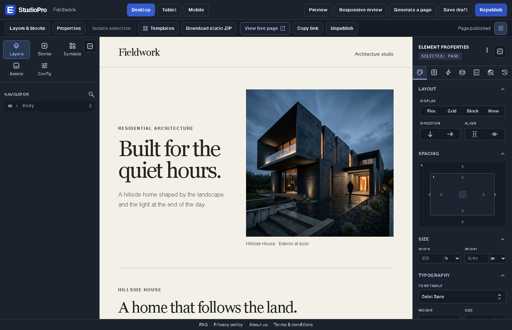
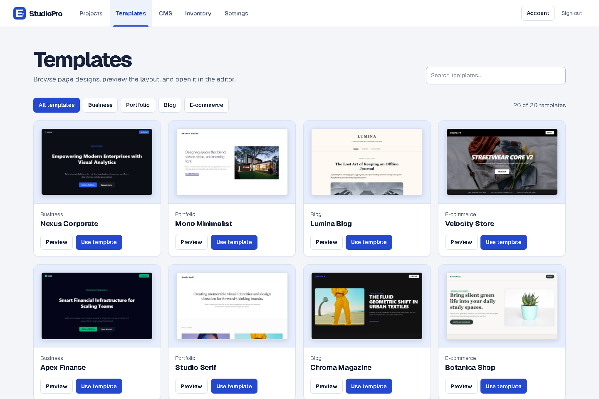
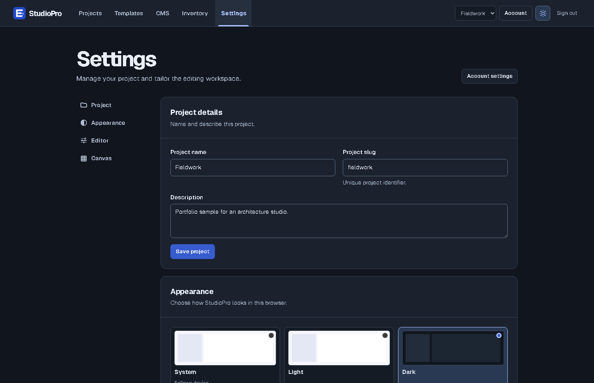

# StudioPro

StudioPro is a visual website builder. Start from a template, edit pages on a responsive canvas, then publish a shareable URL or download a static ZIP.

**[Open StudioPro](https://studiopro.hostless.app/)** · [Try the editor without an account](https://studiopro.hostless.app/demo) · [View the Fieldwork sample](https://studiopro.hostless.app/showcase)

## Screenshots

**Visual editor** — Fieldwork on the canvas with the layers panel and element properties open.



**Template library** — 20 editable designs with live previews and category filters.



**Workspace settings** — Project details and Light, Dark, and System appearance options.



## What you can do

- Design with reusable blocks and linked symbols. Isolate a component or compare desktop, tablet, and mobile previews.
- Manage pages, CMS collections, product inventory, and image uploads from your workspace.
- Save drafts, restore checkpoints, publish or unpublish pages, and export static HTML, CSS, and assets as a ZIP.
- Generate a draft, rewrite copy, or suggest SEO metadata with Gemini when configured. Built-in suggestions also work without a provider key.

The frontend uses Vue 3, Vite, Tailwind CSS, and GrapesJS. Laravel and Sanctum serve the API. Production runs on Hostless with Neon Postgres and object storage.

## Run locally

Install Node.js 24, Composer 2, and PHP 8.4.28 or later in the 8.4 or 8.5 series. Enable PDO SQLite, fileinfo, GD, and ZIP. Enable PDO PostgreSQL if you use Neon.

1. In `backend`, run `composer install`. If `.env` is missing, copy `.env.example` to `.env` and run `php artisan key:generate`.
2. In `backend`, run `php artisan migrate` and `php artisan serve --no-reload`. To seed the Fieldwork sample, run `php artisan studio:provision owner@example.test` and enter a password when prompted.
3. In another terminal, run `npm ci --ignore-scripts --prefix frontend` and `npm run dev --prefix frontend`. Open [the local app](http://127.0.0.1:5173) to create an account or sign in.

Vite proxies API requests to Laravel at `127.0.0.1:8000`. The default environment uses SQLite and local files. Put optional AI credentials in the Laravel environment.

## Build and test

```sh
npm run build
npm run test:unit --prefix frontend
npm exec --prefix frontend -- playwright install chromium
npm run test:e2e --prefix frontend
npm run test:e2e:public --prefix frontend
```

Run `php artisan test` from `backend` for the Laravel suite. The private browser suite starts its own PHP server and SQLite fixture. Set `PHP_BINARY` if PHP is outside your PATH.

See [deployment and Neon setup](DEPLOYMENT.md) for the full workspace and the optional Cloudflare portfolio build.
